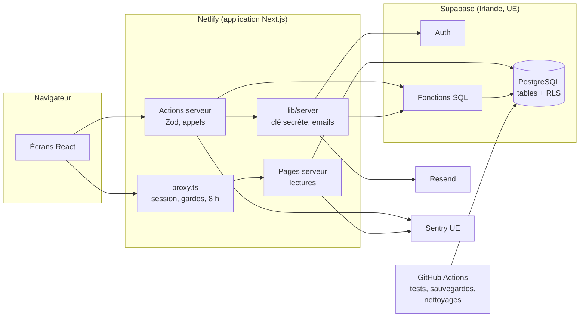
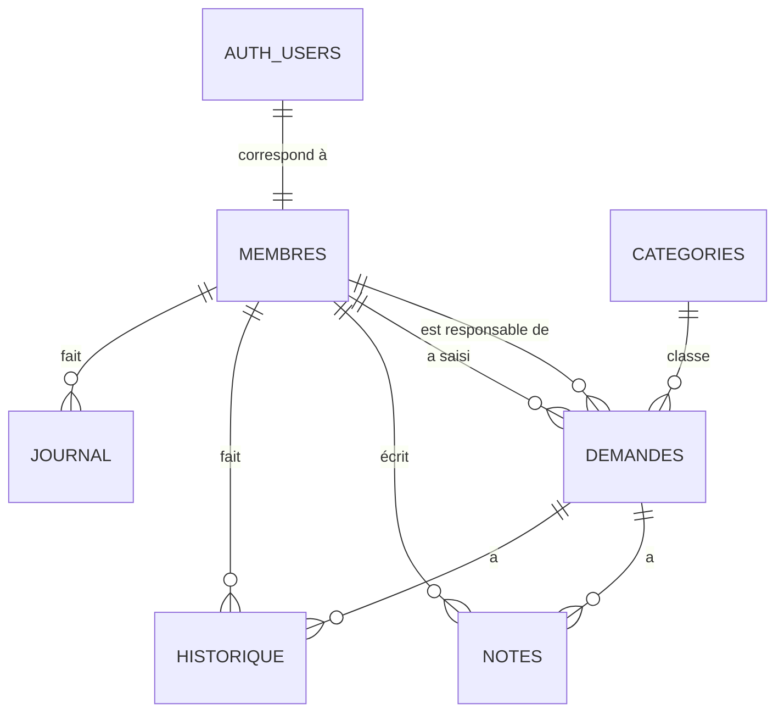
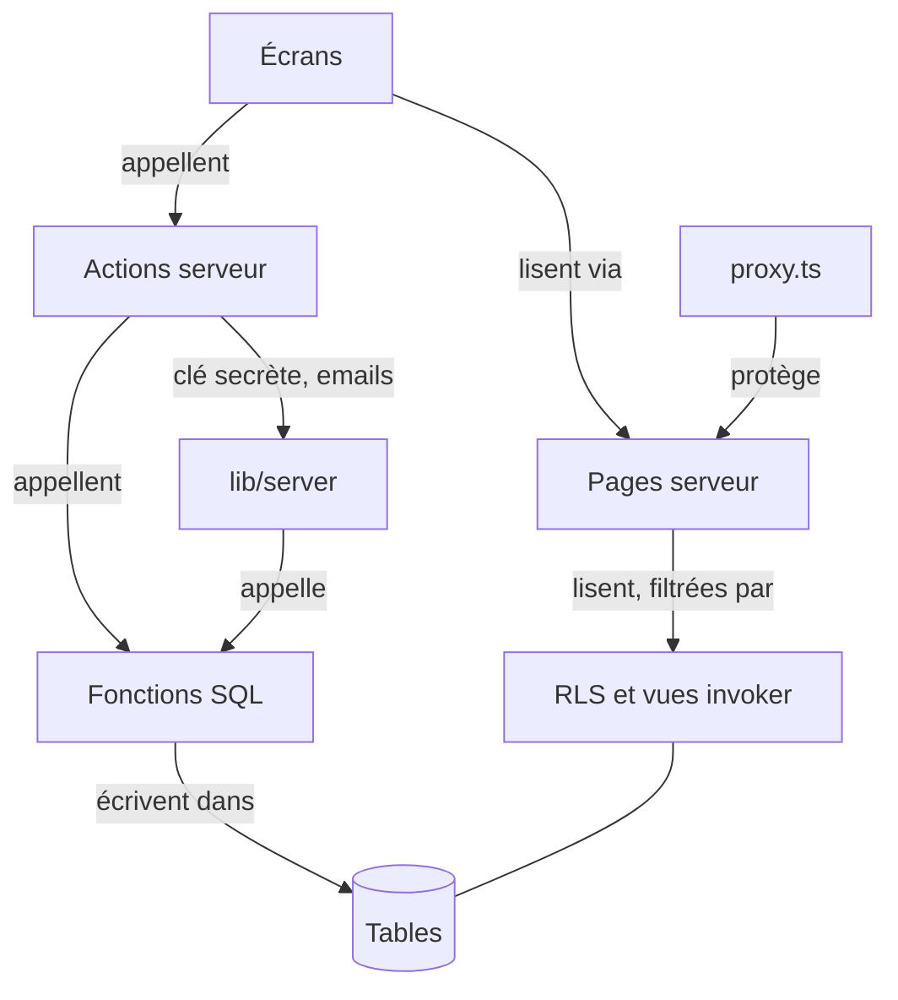
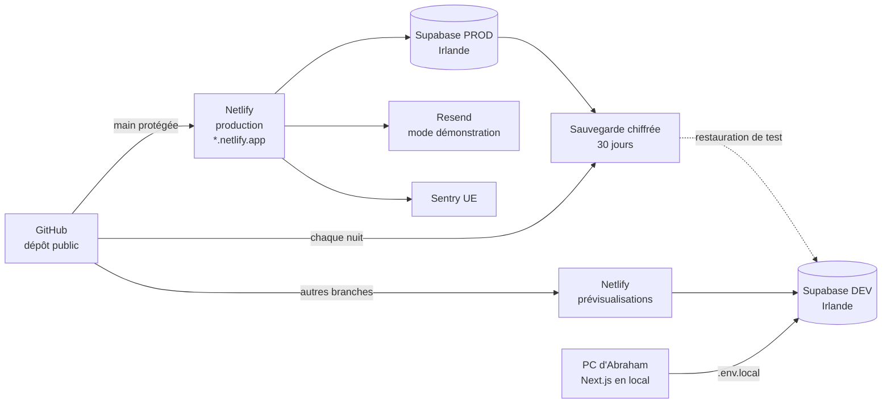

# Architecture — Nova Services

Ce document fixe **comment l'application est construite** : les outils, les briques, les données, et les règles (AD-1 à AD-31) que toutes les stories devront respecter pour que les morceaux construits séparément s'emboîtent. Il part du [PRD](../../prds/prd-coursenia-2026-11-03/prd.md) et de l'UX ([DESIGN.md](../../ux-designs/ux-coursenia-2026-11-03/DESIGN.md), [EXPERIENCE.md](../../ux-designs/ux-coursenia-2026-11-03/EXPERIENCE.md)). Il a été validé par trois relecteurs ([rapport](reviews/validation-report.md)) puis corrigé avec l'accord d'Abraham.

**Contraintes :**
- **budget : 0 €**, offres gratuites uniquement ;
- **environ 10 collaborateurs** ;
- quelques dizaines à quelques centaines de demandes par semaine ;
- projet de formation, avec des **données fictives**.

Les choix marqués **[ADOPTÉ]** ont été validés par Abraham le 03/11/2026. Les points à vérifier pendant la construction sont regroupés au §10.

## 1. La stack, et pourquoi

| Outil | Version (npm, 03/11/2026) | Rôle | Pourquoi ce choix |
|---|---|---|---|
| **Next.js** | 16.4 | Écrans et serveur dans un seul projet | C'est l'outil enseigné en formation, et il réunit l'interface et le code serveur : un seul projet à comprendre et à déployer. |
| **React** | 19.3 | Construction des écrans | Fourni avec Next.js. |
| **TypeScript** | version fournie par Next.js | Langage | Il signale beaucoup d'erreurs avant même de lancer l'application, ce qui aide à vérifier le code produit par l'IA. |
| **Supabase** (PostgreSQL + Auth) | supabase-js 2.118, @supabase/ssr 0.12, CLI 3.0 | Base de données, comptes et connexion | Vu en séquence 2 : il gère les mots de passe et les règles d'accès dans la base (RLS), sans serveur à installer. |
| **Tailwind CSS** | 4.3 | Mise en forme | Fourni avec shadcn/ui ; les couleurs de DESIGN.md deviennent des réglages réutilisables. |
| **shadcn/ui** (base Radix) | CLI 4.23 | Composants | Choisi dans l'UX : composants accessibles et gratuits. On choisit la base **Radix**, la plus documentée. |
| **Zod** | 4.6 | Vérification des formulaires | La même règle vérifie le formulaire à l'écran et sur le serveur. |
| **Resend** (sans domaine) | 6.37 | Envoi des emails | Gratuit, et utilisable sans acheter de domaine ; dans ce mode, il n'envoie qu'à l'adresse d'Abraham (AD-13). [ADOPTÉ] |
| **Sentry** (région UE) | @sentry/nextjs 11.10 | Suivi des erreurs | Gratuit jusqu'à 5 000 erreurs par mois, alertes par email, installation guidée pour Next.js. [ADOPTÉ] |
| **Vitest** | 5.1 | Tests des règles et de la base | Rapide et simple. |
| **Playwright** + axe | 1.64 | Tests des parcours et de l'accessibilité | Il rejoue les parcours UJ-1 à UJ-4 comme un utilisateur et contrôle l'accessibilité de base (NFR-6). |
| **Netlify** (offre Free) | Node 22 | Hébergement | Gratuit, usage professionnel permis, retour à une version précédente en un clic. [ADOPTÉ] |
| **GitHub** + **GitHub Actions** | — | Versions du code, tâches automatiques | Gratuit pour un dépôt public ; le jury peut lire le code. [ADOPTÉ] |

**Démarrage du projet :**

```bash
npx create-next-app@16.4 coursenia-app --yes --no-cache-components
npx shadcn@4.23 init --base radix
```

Le nouveau mode de cache de Next.js 16 (*Cache Components*) est **désactivé** : il oblige à revoir chaque page qui dépend de la personne connectée, et nos volumes ne le justifient pas. Les options exactes seront vérifiées à la story 1.1 (§10).

## 2. Les briques et ce que fait chacune

**Principe (paradigme) : « serveur d'abord, sécurité dans la base ».** Le navigateur n'affiche que ce que le serveur lui envoie et ne parle **jamais** à la base, même pour la connexion. La base vérifie elle-même chaque droit (RLS) et fait elle-même chaque changement (fonctions SQL verrouillées). Ainsi, même un appel malveillant qui contourne l'écran est bloqué.



| Brique | Ce qu'elle fait | Ce qu'elle ne fait jamais |
|---|---|---|
| **Écrans** (`app/`, composants) | Afficher les données reçues ; gérer formulaires et états (vide, chargement, erreur, complet) | Parler à Supabase ; décider d'un droit |
| **`proxy.ts`** | Rafraîchir la session, renvoyer vers la connexion si besoin, déconnecter après 8 h (AD-21, AD-28) | Lire des données métier |
| **Pages serveur** | Lire avec la session de la personne connectée ; la base filtre selon ses droits | Modifier des données |
| **Actions serveur** (`lib/actions/`) | Revérifier la session, valider avec Zod, appeler **une** fonction SQL, renvoyer un résultat (AD-7) | Écrire directement dans une table |
| **`lib/server/`** | Seul endroit qui utilise la clé secrète Supabase et la clé Resend : dépôt public, invitations, liens, blocage de comptes, envoi d'emails | Être importé par un écran |
| **Fonctions SQL** (`supabase/migrations/`) | Faire chaque changement d'un seul bloc : vérifier le droit et la règle, modifier, écrire l'historique et le journal | Être appelables par un visiteur |
| **RLS** | Filtrer chaque lecture des membres connectés | — |
| **Supabase Auth** | Comptes, mots de passe, sessions, liens d'invitation et de réinitialisation | Envoyer des emails ; stocker le rôle |
| **GitHub Actions** | Tests à chaque envoi ; chaque nuit : sauvegarde, nettoyages, réveil des projets Supabase | — |

## 3. Les données principales et leurs liens



| Table | Contenu | Remarques |
|---|---|---|
| `membres` | Nom, email, rôle, état | Même identifiant que le compte Auth. Source unique des droits (AD-3). Jamais supprimée, sauf invitation annulée (AD-17). |
| `categories` | Nom, nom normalisé, actif | Nom normalisé unique, sans tenir compte des accents ni des majuscules. |
| `demandes` | Référence, jeton de confirmation, clé d'envoi, canal, nom, email, téléphone, société, objet, description, catégorie, statut, priorité, responsable, saisie par, date de consentement, état de l'email, dates (création, dernier passage à Traitée, mise à jour) | Codes fermés (AD-18). Email en minuscules (AD-31). |
| `notes` | Demande, auteur, texte, date | Ajout seulement (AD-5). |
| `historique` | Demande, auteur (ou « demandeur »), type, ancienne et nouvelle valeur (en codes ou identifiants), date | Ajout seulement ; types fermés (AD-19). |
| `journal` | Type, détails structurés, auteur, date | Ajout seulement ; types fermés ; jamais de donnée de demandeur (AD-14, AD-19) ; purge au-delà d'un an (AD-23). |
| `parametres` | Une ligne : nom affiché, email de contact, durée de conservation en mois (6 à 60) | Créée par migration (AD-27). |
| `compteurs_reference` | Année (heure de Paris), dernier numéro | AD-6. |
| `envois_formulaire` | Empreinte HMAC de l'IP, date | Anti-spam ; effacé au-delà d'une heure (AD-23). |
| `tentatives_connexion` | Empreinte de l'email, empreinte de l'IP, date, réussie ou non | Blocage après 5 échecs (AD-21) ; effacé au-delà d'un jour. |
| `effacements` | Références effacées et date, sans autre donnée | Pour refaire les effacements après une restauration (AD-30). |

Lecture des listes : une **vue** `demandes_liste`, qui respecte RLS (`security_invoker`), ajoute le nom de la catégorie, le nom du responsable et une colonne de recherche normalisée (sans accents, en minuscules). La liste et le tableau de bord la lisent avec **le même** constructeur de filtres (AD-25).

## 4. Règles communes

### 4.1 Comptes

- Connexion par email et mot de passe, **via une action serveur** (AD-21). Le navigateur n'a pas de client Supabase. Pas d'inscription libre.
- **Invitation** (AD-17) : l'action admin crée le compte Auth, puis la ligne `membres` (état `invite`), et génère un **lien d'invitation valable 24 h**. Le lien est envoyé par email si l'adresse est autorisée (AD-13), sinon **affiché à l'administrateur pour qu'il le copie**. Au premier mot de passe, `activer_mon_compte()` passe l'état à `actif`.
- **Mot de passe oublié** : lien valable 24 h, envoyé selon la même règle ; un administrateur peut aussi générer un lien de réinitialisation pour un membre.
- **Désactivation** : `desactiver_membre` met l'état à `desactive` et remet ses demandes En cours en Nouvelle ; le compte est ensuite bloqué dans Auth. La réactivation fait l'inverse.
- **Session** : déconnexion après 8 h ; blocage de 15 minutes après 5 échecs de suite (AD-21).

### 4.2 Droits d'accès

| Qui | Lire | Écrire |
|---|---|---|
| Visiteur (non connecté) | **Rien dans la base.** Les pages publiques reçoivent du serveur les catégories actives et le contact (`infos_publiques()`), et la confirmation via un jeton (AD-16) | Rien. Le dépôt est fait par le serveur, après ses contrôles (AD-16) |
| Collaborateur actif | Demandes (vue), notes, historique, catégories ; dans `membres` : seulement l'identifiant, le nom et l'état | Uniquement via les fonctions de traitement |
| Administrateur actif | Tout, y compris comptes (`lister_comptes()`), paramètres et journal | En plus : attribuer, comptes, catégories, paramètres, effacer, purger |
| Compte invité ou désactivé | Rien | Rien |

### 4.3 Erreurs

- Chaque action serveur renvoie `{ ok: true, donnees }` ou `{ ok: false, code, message }` (AD-7).
- Une fonction SQL signale une erreur prévue par un **code** (AD-20), traduit en message français par `lib/erreurs.ts`.
- Les erreurs imprévues vont dans Sentry, sans donnée personnelle (AD-14). L'écran affiche « Le serveur ne répond pas… » avec « Réessayer ».
- Un email non envoyé n'annule jamais l'action : son état est noté sur la demande et dans le journal (AD-13).

## 5. Invariants (règles que toutes les stories doivent respecter)



Seules les flèches dessinées sont permises.

### AD-1 — Serveur d'abord

- **Binds :** all
- **Prevents :** une partie de l'application qui parle à la base depuis le navigateur et contourne les contrôles.
- **Rule :** le navigateur n'a **aucun** client Supabase. Toute lecture passe par une page serveur, toute écriture et la connexion par une action serveur. Chaque action serveur revérifie la session (`getClaims()`) avant d'agir, même si `proxy.ts` l'a déjà fait.

### AD-2 — La base est la frontière de sécurité

- **Binds :** NFR-1, règle 10, FR-1, FR-2, FR-10
- **Prevents :** un droit vérifié à l'écran mais pas dans la base, et des droits accordés par défaut par Supabase.
- **Rule :**
  - Une migration retire **tous** les droits par défaut (tables, vues, séquences, fonctions) aux rôles `anon`, `authenticated` et `public`, y compris pour les futurs objets (`ALTER DEFAULT PRIVILEGES`).
  - Le rôle `anon` n'a **aucun** droit.
  - `authenticated` reçoit seulement `SELECT` sur les tables et colonnes listées au §4.2, protégées par RLS via `prive.est_membre_actif()`.
  - Aucune règle d'écriture directe.
  - Toute vue est `security_invoker = true` ; pas de vue matérialisée.
  - Un test automatique vérifie, pour chaque table et vue, que `anon` ne lit rien.

### AD-3 — Les droits viennent de la table `membres` [ADOPTÉ]

- **Binds :** FR-6, FR-9, FR-10, règle 7
- **Prevents :** un compte désactivé ou rétrogradé qui garde ses droits ; une boucle de RLS sur `membres`.
- **Rule :** le rôle et l'état sont lus à chaque requête par `prive.est_membre_actif()` et `prive.est_admin()`. Ce sont des fonctions `SECURITY DEFINER STABLE` du schéma `prive`, utilisées par toutes les règles RLS et toutes les fonctions. Le rôle n'est jamais stocké dans les métadonnées Auth. Tests sur trois profils : visiteur, collaborateur, administrateur.

### AD-4 — Un changement = une fonction SQL

- **Binds :** règles 1 à 9 ; FR-8, FR-9, FR-14 à FR-18, FR-20 à FR-22, FR-24, FR-25
- **Prevents :** deux écrans qui changent une donnée différemment, ou un changement sans trace.
- **Rule :** chaque action métier a **sa** fonction SQL :
  - demandes : `deposer_demande`, `saisir_demande`, `prendre_en_charge`, `attribuer`, `liberer`, `changer_statut`, `classer_sans_suite`, `changer_priorite`, `changer_categorie`, `ajouter_note`, `noter_resultat_email` ;
  - comptes : `creer_membre`, `activer_mon_compte`, `modifier_membre`, `desactiver_membre`, `reactiver_membre`, `annuler_invitation` ;
  - administration : `ajouter_categorie`, `renommer_categorie`, `activer_categorie`, `desactiver_categorie`, `modifier_parametres` ;
  - données et nettoyages : `effacer_demandeur`, `purger_expirees`, `purger_technique`, `rejouer_effacements`.

  En un seul bloc, chaque fonction vérifie le droit et la règle, modifie, puis écrit l'historique et le journal. `changer_statut` refuse le passage Nouvelle → Traitée : seul `classer_sans_suite(id, note)` le permet, avec sa note, en une fois. Une prise en charge simultanée est réglée par une modification conditionnelle ; le second reçoit `DEJA_PRISE`. Une nouvelle action = une nouvelle fonction ajoutée à cette liste.

### AD-5 — Historique, notes et journal en ajout seulement

- **Binds :** règle 6, FR-17, FR-18, FR-26, OPS-2
- **Prevents :** la modification ou l'effacement discret d'une trace.
- **Rule :** aucune fonction ne modifie une ligne de `historique`, `notes` ou `journal`. Seules suppressions permises : l'effacement complet d'une demande (`effacer_demandeur`, `purger_expirees`, avec son historique et ses notes) et la purge du journal au-delà d'un an (`purger_technique`).

### AD-6 — Référence fabriquée par la base

- **Binds :** FR-2, FR-25
- **Prevents :** deux demandes avec la même référence.
- **Rule :** `NOVA-AAAA-NNNN` est créée dans `deposer_demande` et `saisir_demande` à partir de `compteurs_reference`, en verrouillant la ligne de l'année (année à l'heure de Paris). Le numéro s'allonge au-delà de 9 999. Le code de l'application ne fabrique jamais de référence.

### AD-7 — Une seule forme de résultat

- **Binds :** all
- **Prevents :** des écrans qui affichent des erreurs techniques, chacun à sa façon.
- **Rule :** les actions serveur renvoient `{ ok: true, donnees } | { ok: false, code, message }` ; elles appellent la base via l'utilitaire unique `lib/server/appeler.ts`. Aucune exception ne remonte jusqu'à l'écran. Après une action réussie, l'action rafraîchit les pages concernées (`revalidatePath`).

### AD-8 — Une seule règle de validation par formulaire

- **Binds :** FR-1, FR-5, FR-8, FR-21, FR-25, NFR-9
- **Prevents :** un formulaire accepté à l'écran mais refusé par le serveur, ou l'inverse.
- **Rule :** un schéma Zod par formulaire (`lib/schemas/`), utilisé à l'écran et dans l'action. Les longueurs maximales et les codes fermés sont aussi des contraintes de la base.

### AD-9 — Secrets et environnements séparés [ADOPTÉ]

- **Binds :** NFR-2, NFR-3
- **Prevents :** une clé dans le dépôt public, ou la production branchée sur la base de développement.
- **Rule :**
  - Deux projets Supabase (dev, prod), région Irlande (`eu-west-1`, Union européenne) ; choix validé par Abraham le 03/11/2026 à la création du projet de développement.
  - On utilise les **nouvelles clés** Supabase : `NEXT_PUBLIC_SUPABASE_PUBLISHABLE_KEY` et `SUPABASE_SECRET_KEY`. Les anciennes clés `anon` et `service_role` sont désactivées.
  - Les clés sont dans `.env.local` (exclu de Git) en développement et dans les variables Netlify en production.
  - Les clés secrètes, Resend et le secret HMAC ne sont lus que dans `lib/server/`.
  - Une recherche automatique de secrets tourne à chaque envoi de code.

### AD-10 — La structure de la base ne change que par migrations

- **Binds :** NFR-4, NFR-5, OPS-4
- **Prevents :** une base de production différente du code, ou une mise à jour impossible à annuler.
- **Rule :** toute modification de structure est un fichier daté dans `supabase/migrations/`, appliqué en dev puis en prod avec la CLI (`supabase db push`). On ajoute d'abord, on retire à la version suivante, pour que la version précédente du code fonctionne encore.

### AD-11 — Versions, mise en ligne et retour arrière [ADOPTÉ]

- **Binds :** NFR-4, NFR-5, NFR-8
- **Prevents :** ne pas savoir quelle version tourne, publier du code non testé, ou couper le site faute de crédits.
- **Rule :**
  - `main` est la production et elle est protégée : on n'y fusionne que si les tests GitHub sont verts. La commande de build Netlify relance aussi les tests rapides (`npm run verifier && next build`).
  - Chaque mise en ligne reçoit une étiquette `vX.Y.Z`, égale à la version de `package.json`, injectée au build dans `NEXT_PUBLIC_APP_VERSION` et affichée en bas de page. Une sauvegarde est lancée juste avant.
  - **Crédits Netlify Free** : 300 par mois, 15 par mise en ligne en production. On groupe donc les mises en ligne (10 par mois au maximum) et on vérifie les crédits chaque semaine. Plan B : l'offre payante de Netlify.
  - Retour arrière : « Publish deploy » sur la version précédente, possible pendant 30 jours sur l'offre Free. `NETLIFY_NEXT_SKEW_PROTECTION=true`.

### AD-12 — Sauvegardes et restauration hors de Supabase [ADOPTÉ]

- **Binds :** OPS-3, OPS-4, FR-22
- **Prevents :** perdre les données (l'offre gratuite de Supabase ne sauvegarde pas) et la mise en pause des projets.
- **Rule :**
  - **Chaque nuit**, une tâche GitHub Actions se connecte à la production par le **pooler en mode session** et exporte trois fichiers : rôles, structure, et données y compris les comptes (`--data-only --use-copy`). Elle les chiffre avec une phrase secrète (secret GitHub) et les garde 30 jours.
  - La même tâche peut être lancée à la main avant une mise en ligne.
  - La **restauration de test** se fait dans GitHub Actions vers le projet de développement, puis on y appelle `rejouer_effacements()`. Le projet dev est remis à ses données fictives après l'essai.
    - **Décision du 06/11/2026 (story 3.4)** : la restauration de test se fait dans une base Supabase jetable créée dans la machine GitHub Actions, et non dans `nova-dev` (base partagée) ; `nova-dev` n'est jamais touché, la remise à ses données fictives devient sans objet.
  - Une tâche quotidienne interroge les deux projets pour éviter leur mise en pause.

### AD-13 — Emails : un seul module, mode démonstration à 0 € [ADOPTÉ]

- **Binds :** FR-3, FR-7, FR-8, FR-25, risque §7 du PRD
- **Prevents :** des emails envoyés par plusieurs chemins, un échec d'email qui fait échouer une action, ou une dépense non voulue.
- **Rule :**
  - Tous les emails partent de `lib/server/emails.ts`, via Resend. **Supabase Auth n'envoie aucun email** : les liens d'invitation et de réinitialisation, valables 24 h, sont générés par l'API d'administration (`generateLink`).
  - **Sans domaine acheté**, Resend n'envoie qu'à l'adresse du compte d'Abraham. Une liste `EMAILS_AUTORISES` fixe les destinataires possibles. Pour les autres, rien n'est envoyé et l'état est `non_envoye_demo`, affiché « Email non envoyé (mode démonstration) ». Pour une invitation ou une réinitialisation demandée par un administrateur, le lien lui est **affiché pour qu'il le copie**.
  - Les fonctions SQL renvoient les données de l'email. L'action l'envoie **après** l'enregistrement, puis appelle `noter_resultat_email`, qui fait passer `en_attente` à `envoye`, `echec`, `non_envoye_demo` ou `sans_email`.
  - Passage en vraie production, sans changement de code : vérifier un domaine dans Resend, puis `EMAIL_EXPEDITEUR` = une adresse de ce domaine (défaut `onboarding@resend.dev`) et `EMAILS_AUTORISES=*` (toutes les adresses) ; une liste vide signifie « personne » (démonstration).

### AD-14 — Pas de donnée personnelle dans les outils de suivi

- **Binds :** OPS-1, OPS-2, §8 du PRD
- **Prevents :** une fuite de données via Sentry, le journal ou les empreintes.
- **Rule :**
  - L'organisation Sentry est créée dans la **région UE**.
  - Configuration obligatoire : `dataCollection: { userInfo: false, cookies: false, httpBodies: [] }`, pas de *Session Replay*, `beforeSend` qui retire `request.data` et les paramètres d'URL, pas de `setUser`, alerte par email sur une nouvelle erreur. Un test vérifie ces options.
  - Le journal cite les membres, jamais les demandeurs.
  - Les IP et emails des tentatives sont enregistrés en **empreintes HMAC**, avec un secret serveur. L'IP est lue uniquement dans l'en-tête Netlify `x-nf-client-connection-ip`.

### AD-15 — Fonctions SQL verrouillées

- **Binds :** NFR-1, AD-2, AD-4
- **Prevents :** une fonction qui, appelée directement avec la clé publique, contourne les contrôles.
- **Rule :**
  - Chaque fonction `SECURITY DEFINER` déclare `SET search_path = ''`, nomme ses tables avec leur schéma et vérifie le droit **en première instruction**.
  - `EXECUTE` est retiré à tous, puis accordé fonction par fonction : à `authenticated` pour les fonctions de l'espace équipe, à `service_role` seulement pour `deposer_demande`, `noter_resultat_email`, `creer_membre`, `purger_technique` et `rejouer_effacements`.
  - Les utilitaires (`est_admin`, `ecrire_historique`, `ecrire_journal`…) sont dans le schéma `prive`, non exposé.
  - Un test liste les fonctions exécutables par chaque rôle et le compare à la liste attendue.

### AD-16 — Dépôt public et confirmation par le serveur

- **Binds :** FR-1 à FR-5
- **Prevents :** un dépôt qui contourne l'anti-spam, ou une page de confirmation qui expose des données.
- **Rule :**
  - L'action `deposer` vérifie, dans cet ordre : le champ piège, Zod, la limite (5 envois en 10 minutes par empreinte d'IP, `envois_formulaire`). Ensuite seulement, elle appelle `deposer_demande` avec la clé secrète.
  - La fonction crée un **jeton de confirmation aléatoire**. La page `/confirmation/[jeton]` affiche seulement la référence, l'objet et le contact, et seulement pendant 24 h, via `lire_confirmation(jeton)`, côté serveur.
  - La référence n'apparaît jamais seule dans une adresse publique.

### AD-17 — Cycle de vie d'un compte

- **Binds :** FR-8, FR-9, règle 7, AD-3
- **Prevents :** deux façons de créer la ligne `membres`, ou un compte Auth sans ligne `membres`.
- **Rule :**
  - **Invitation** : l'action admin (session vérifiée) crée le compte Auth avec la clé secrète, puis appelle `creer_membre`. Si cette étape échoue, elle supprime le compte Auth créé. Aucun déclencheur sur `auth.users`.
  - **Activation** : la page `/auth/confirmer` traite le lien côté serveur ; au premier mot de passe, `activer_mon_compte()`.
  - **Renvoyer l'invitation** : nouveau lien. **Annuler l'invitation** : possible seulement à l'état `invite` ; supprime le compte Auth et la ligne `membres`.
  - **Désactiver / réactiver** : fonction SQL d'abord, puis blocage ou déblocage dans Auth.

### AD-18 — Codes fermés

- **Binds :** all
- **Prevents :** « En cours » d'un côté et `en_cours` de l'autre.
- **Rule :** valeurs stockées en minuscules, sans accent :
  - `statut` : `nouvelle`, `en_cours`, `traitee` ;
  - `priorite` : `basse`, `normale`, `haute` ;
  - `canal` : `formulaire`, `telephone`, `email` ;
  - `role` : `collaborateur`, `administrateur` ;
  - `etat` (membre) : `invite`, `actif`, `desactive` ;
  - `etat_email` : `en_attente`, `envoye`, `echec`, `non_envoye_demo`, `sans_email`.

  Ces listes sont des contraintes `CHECK` dans la base. Elles sont recopiées une seule fois dans `lib/domaine.ts`, avec les libellés affichés ; Zod, les filtres et les adresses de page utilisent ce fichier.

### AD-19 — Format de l'historique et du journal

- **Binds :** règle 6, FR-18, FR-26, OPS-2
- **Prevents :** deux stories qui écrivent l'historique dans des formats différents.
- **Rule :**
  - Types d'historique fermés : `creation`, `prise_en_charge`, `attribution`, `liberation`, `changement_statut`, `classement_sans_suite`, `changement_priorite`, `changement_categorie`, `note_ajoutee`, `retour_nouvelle`.
  - Les valeurs sont des codes (AD-18) ou des identifiants (catégorie, membre), jamais des libellés. Le texte d'une note n'est jamais recopié.
  - Types de journal fermés : `compte`, `parametre`, `categorie`, `donnees`, `email`, `connexion`.
  - L'écriture passe uniquement par `prive.ecrire_historique` et `prive.ecrire_journal` ; l'affichage, par un composant unique qui traduit les codes.
  - Le nom d'une catégorie renommée s'affiche avec son nom actuel (règle 9 du PRD).

### AD-20 — Remontée des erreurs SQL

- **Binds :** AD-7, AD-4
- **Prevents :** chaque story qui invente sa façon de signaler une erreur.
- **Rule :**
  - Une erreur prévue est levée par `RAISE EXCEPTION USING ERRCODE = 'P0001', MESSAGE = '<CODE>'`, avec un détail JSON si besoin.
  - Les codes sont en majuscules (`DEJA_PRISE`, `PASSAGE_INTERDIT`, `DROIT_INSUFFISANT`, `TROP_D_ENVOIS`, `NOM_DEJA_PRIS`, `DERNIER_ADMIN`…).
  - La liste est recopiée dans `lib/erreurs.ts`, avec les messages. Un test vérifie que les deux listes concordent.

### AD-21 — Connexion et session

- **Binds :** FR-6, NFR-9, OPS-2
- **Prevents :** un blocage ou une limite de session promis mais non disponibles dans l'offre gratuite de Supabase.
- **Rule :**
  - L'action `connexion` refuse si 5 échecs ont eu lieu dans les 15 dernières minutes pour la même empreinte d'email ou d'IP (`tentatives_connexion`). Le blocage est noté au journal.
  - `proxy.ts` déconnecte au-delà de 8 h après la connexion, d'après l'heure de connexion lue dans la session (champ à confirmer, §10).
  - Mot de passe : 8 caractères minimum (réglage Supabase et Zod).

### AD-22 — Dates gérées par la base

- **Binds :** FR-14, FR-15, FR-24
- **Prevents :** une story qui oublie de mettre à jour la date de traitement ou de modification.
- **Rule :** un seul déclencheur sur `demandes` met à jour `mis_a_jour_le` à chaque modification, et `traitee_le` à chaque passage à `traitee`. Aucune fonction ne les écrit elle-même.

### AD-23 — Conservation et nettoyages

- **Binds :** §8 du PRD, FR-5, FR-24, OPS-2
- **Prevents :** des données gardées plus longtemps que promis.
- **Rule :**
  - Durée de conservation : `duree_conservation_mois` (6 à 60), comparée à `traitee_le`.
  - `purger_expirees` est lancée par un administrateur.
  - `purger_technique` est lancée chaque nuit par GitHub Actions. Elle efface les empreintes d'IP de plus d'une heure, les tentatives de connexion de plus d'un jour et le journal de plus d'un an.
  - `deposer_demande` efface aussi au passage les empreintes de plus d'une heure.

### AD-24 — Heure de Paris

- **Binds :** all
- **Prevents :** une date affichée en heure anglaise sur Netlify, ou une référence sur la mauvaise année le 1er janvier.
- **Rule :** la base stocke en `timestamptz`. L'année de référence et les durées sont calculées en `Europe/Paris`. Tout affichage passe par `lib/format.ts`, qui fixe ce fuseau.

### AD-25 — Une seule façon de lire et filtrer les demandes

- **Binds :** FR-11, FR-12, FR-19
- **Prevents :** un chiffre du tableau de bord qui ne correspond pas à la liste filtrée.
- **Rule :** la liste et les compteurs lisent la vue `demandes_liste` à travers `lib/filtres.ts`, qui traduit les filtres de l'adresse de page (`?statut=non_traitees&responsable=aucun`) en requête. Le tableau de bord ne calcule rien d'autre. Les pages de l'espace équipe ne sont jamais mises en cache.

### AD-26 — Pas de double envoi

- **Binds :** FR-2, FR-25
- **Prevents :** deux demandes créées par un double clic ou une connexion qui coupe.
- **Rule :** chaque formulaire porte une `cle_envoi` aléatoire, créée à l'affichage et unique en base. Un second envoi avec la même clé renvoie la demande déjà créée.

### AD-27 — Données de départ et données de test

- **Binds :** FR-20, FR-21, NFR-3, NFR-8
- **Prevents :** une production sans catégories ni administrateur, ou des tests qui abîment des données réelles.
- **Rule :**
  - Les 5 catégories de départ et la ligne `parametres` sont créées **par migration**, donc aussi en production.
  - Le premier administrateur est créé par le script documenté `scripts/premier-admin.ts`.
  - En développement, les données fictives viennent de `supabase/seed.sql`. Les données créées par les tests portent le préfixe `TEST-` et sont effacées à la fin.
  - Les tests refusent de démarrer si l'adresse Supabase est celle de la production.

### AD-28 — Gardes de pages

- **Binds :** FR-6, FR-10
- **Prevents :** une page de l'espace équipe ou d'administration oubliée sans protection.
- **Rule :**
  - `proxy.ts` renvoie vers `/connexion?retour=…` toute adresse `/equipe/*` sans session.
  - La mise en page `app/equipe/layout.tsx` vérifie que le membre est actif.
  - La mise en page `app/equipe/admin/layout.tsx` vérifie le rôle administrateur.
  - Les actions revérifient elles-mêmes (AD-1). Après connexion, on revient à l'adresse demandée si elle commence par `/equipe`.

### AD-29 — Toujours un administrateur actif

- **Binds :** règle 8, FR-9
- **Prevents :** deux administrateurs qui se désactivent mutuellement en même temps.
- **Rule :** `modifier_membre` et `desactiver_membre` prennent un verrou (`pg_advisory_xact_lock`), refusent si le compte visé est celui de l'appelant, et refusent (`DERNIER_ADMIN`) s'il ne resterait aucun administrateur actif.

### AD-30 — Registre des effacements

- **Binds :** FR-22, OPS-4
- **Prevents :** des données effacées à la demande d'une personne qui réapparaissent après une restauration.
- **Rule :** `effacer_demandeur` inscrit les références effacées dans `effacements` (sans autre donnée). Après toute restauration, `rejouer_effacements()` efface à nouveau ces références.

### AD-31 — Emails normalisés

- **Binds :** FR-8, FR-22
- **Prevents :** un effacement RGPD partiel (`Jean@…` et `jean@…`), ou un compte créé en double.
- **Rule :** les emails sont débarrassés des espaces et mis en minuscules par Zod, et la base l'impose (`CHECK (email = lower(email))`).

## 6. Conventions

| Sujet | Convention |
|---|---|
| Langue du code | Noms métier en français, comme dans le glossaire du PRD ; mots-clés techniques en anglais |
| Base de données | Tables et colonnes en minuscules avec `_` ; identifiants `uuid` ; dates `timestamptz` ; schéma `prive` pour les utilitaires |
| Fichiers | Écrans dans `app/` selon les adresses d'EXPERIENCE.md §2. `lib/actions/demandes.ts` : dépôt, saisie, traitement. `lib/actions/comptes.ts` : connexion, mot de passe, activation. `lib/actions/admin.ts` : membres, catégories, paramètres, données |
| Composants shadcn | Base Radix (`asChild`) ; on ne modifie pas les composants générés, on les enveloppe |
| Tests | Rangés par story (`tests/story-1-1/…`), noms en français ; tests de sécurité dans `tests/securite/` |
| Messages | Uniquement depuis `lib/erreurs.ts`, `lib/domaine.ts` et les textes d'EXPERIENCE.md ; vouvoiement |
| Commits | En français, au présent : « Ajoute le formulaire de dépôt (story 1.1) » |

## 7. Organisation des fichiers (point de départ)

```text
coursenia/
  app/
    (public)/              # formulaire, confirmation/[jeton], connexion, mot de passe
    auth/confirmer/        # traitement des liens d'invitation et de réinitialisation
    equipe/                # espace équipe (layout : membre actif)
      admin/               # administration (layout : administrateur)
  components/              # shadcn/ui et composants Nova (badges, historique…)
  lib/
    actions/               # demandes.ts, comptes.ts, admin.ts
    schemas/               # règles Zod
    server/                # clé secrète, appeler.ts, emails.ts, empreintes HMAC
    supabase/              # clients serveur et proxy
    domaine.ts             # codes et libellés (AD-18)
    erreurs.ts             # codes et messages (AD-20)
    filtres.ts             # filtres partagés (AD-25)
    format.ts              # dates, heure de Paris (AD-24)
  proxy.ts                 # session, gardes, limite de 8 h
  supabase/
    migrations/            # structure, droits, RLS, fonctions, données de départ
    seed.sql               # données fictives de développement
  scripts/premier-admin.ts
  tests/                   # par story, plus tests/securite/
  .github/workflows/       # tests, sauvegarde et nettoyage nocturnes, réveil, restauration de test
  docs/                    # exploitation, support, sécurité, carnet d'usage de l'IA
```

## 8. Hébergement, environnements et coûts



L'adresse de production est l'adresse gratuite fournie par Netlify (`<nom>.netlify.app`).

| Service | Offre | Coût | Limite de l'offre gratuite, et ce qui se passe au-delà |
|---|---|---|---|
| Netlify | Free | 0 € | 300 crédits par mois (15 par mise en ligne). **Au-delà, le site est coupé** jusqu'au mois suivant. Parade : AD-11 ; plan B : offre payante |
| Supabase (×2) | Free | 0 € | 500 Mo par projet ; pause après 7 jours sans activité (évitée par AD-12) ; pas de sauvegarde (remplacée par AD-12). Au-delà : Pro, ~25 $ par mois et par projet |
| Resend | Free, sans domaine | 0 € | N'envoie qu'à l'adresse d'Abraham (mode démonstration, AD-13). Pour écrire aux vrais clients : un domaine (~10 € par an), seulement en vraie production |
| Sentry | Developer | 0 € | 5 000 erreurs par mois, 1 utilisateur |
| GitHub + Actions | Free (dépôt public) | 0 € | Les tâches planifiées sont suspendues après 60 jours sans activité sur le dépôt |
| **Total** | | **0 €** | |

Avec 10 collaborateurs et quelques centaines de demandes par semaine, toutes les offres gratuites suffisent : une demande pèse quelques kilo-octets. La seule limite visible en démonstration : les emails n'arrivent qu'à Abraham. C'est assumé, affiché dans l'application et documenté.

## 9. Correspondance PRD et UX → briques

| Exigences | Écrans (EXPERIENCE.md) | Briques | Règles |
|---|---|---|---|
| FR-1 à FR-5 (dépôt public) | Déposer une demande, Confirmation | Action `deposer`, `deposer_demande`, `lire_confirmation`, `envois_formulaire`, emails | AD-6, AD-8, AD-13, AD-14, AD-16, AD-26 |
| FR-25 (saisie interne) | Saisir une demande | Action `saisir`, `saisir_demande`, emails | AD-4, AD-6, AD-13, AD-26 |
| FR-6, FR-7 (connexion) | Connexion, Mot de passe oublié, Choisir un mot de passe | Action `connexion`, `tentatives_connexion`, `proxy.ts`, `/auth/confirmer`, emails | AD-1, AD-13, AD-21, AD-28 |
| FR-8, FR-9 (comptes) | Comptes | Action admin, `creer_membre`, `modifier_membre`, `desactiver_membre`, `reactiver_membre`, `annuler_invitation`, `lister_comptes` | AD-3, AD-17, AD-29, AD-31 |
| FR-10 (droits) | Toutes | RLS, `prive.est_admin()`, layouts | AD-2, AD-3, AD-15, AD-28 |
| FR-11, FR-12 (liste, recherche) | Liste des demandes | Vue `demandes_liste`, `lib/filtres.ts` | AD-18, AD-25 |
| FR-13 à FR-18 (traitement) | Détail | Fonctions de traitement, composant d'historique | AD-4, AD-5, AD-19, AD-22 |
| FR-19 (tableau de bord) | Tableau de bord, compteur du menu | Vue + `lib/filtres.ts` | AD-25 |
| FR-20, FR-21 (catégories, paramètres) | Catégories, Paramètres | Fonctions dédiées, `infos_publiques()` | AD-4, AD-27 |
| FR-22, FR-24 (effacement, purge) | Données personnelles | `effacer_demandeur`, `purger_expirees`, `effacements` | AD-5, AD-23, AD-30, AD-31 |
| FR-26, OPS-2 (journal) | Journal | `journal`, `prive.ecrire_journal` | AD-5, AD-14, AD-19 |
| NFR-2, NFR-3 | — | 2 projets Supabase, variables Netlify | AD-9, AD-27 |
| NFR-4, NFR-5 | Pied de page (version) | Git, Netlify, migrations | AD-10, AD-11 |
| NFR-6 (accessibilité) | Toutes | Playwright + axe | Conventions §6 |
| NFR-7 (rapidité) | Liste | 2 000 demandes fictives en dev, mesure Playwright | AD-25 |
| NFR-8 (tests) | — | Vitest, Playwright, GitHub Actions, `main` protégée | AD-11 |
| NFR-9 (sécurité de base) | Connexion, formulaires | `tentatives_connexion`, `proxy.ts`, Zod, `npm audit` en CI | AD-8, AD-21 |
| OPS-1 | — | Sentry UE | AD-7, AD-14 |
| OPS-3, OPS-4 | — | GitHub Actions | AD-12, AD-30 |
| OPS-5 à OPS-7 | — | `docs/` | — |

## 10. Hypothèses à vérifier pendant la construction

1. **Pas de Docker** sur le PC : pas de Supabase local. Les tests tournent contre le projet de **développement** (AD-27) ; les exports et restaurations se font dans GitHub Actions (AD-12).
2. Options exactes de `create-next-app` 16.4 (`--no-cache-components`) et de `shadcn init` : à confirmer à la story 1.1.
3. Champ de la session qui donne l'heure de connexion, pour la limite de 8 h (AD-21) : à confirmer. Sinon, un cookie signé est posé à la connexion.
4. En-tête IP de Netlify `x-nf-client-connection-ip` (AD-14) : à confirmer sur une prévisualisation.
5. Régions UE de Netlify (fonctions) et de Resend : à vérifier ; aucune donnée personnelle n'y est stockée durablement.
6. Une durée de lien de 24 h est réglable dans Supabase pour les liens générés par `generateLink` (AD-13, AD-17).
7. Les tâches planifiées de GitHub restent actives grâce à des commits réguliers pendant le projet (règle des 60 jours).

## 11. Ce qui est volontairement laissé pour plus tard

| Sujet | Pourquoi ça peut attendre |
|---|---|
| Suggestion par l'IA (FR-23) | Hors MVP ; fournisseur choisi après la mise en ligne, en vérifiant où sont traitées les données. |
| Nom de domaine et envoi réel des emails | Hors budget de la formation ; le passage se fait sans changer le code (AD-13). |
| Mises à jour en direct | Le PRD et l'UX se contentent d'une mise à jour au chargement de page. |
| Pièces jointes | Hors MVP. |
| Optimisation des performances | Mesurée d'abord avec 2 000 demandes (NFR-7) ; optimisée seulement si besoin. |
