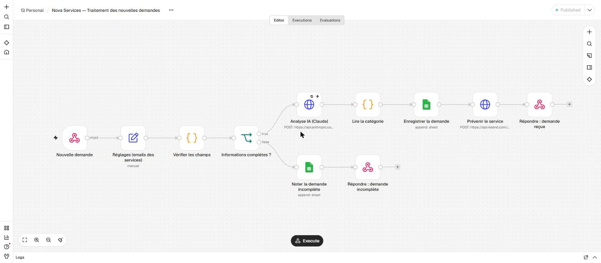

# Workflow N8N — Traitement des nouvelles demandes

> **Suite :** l'agent IA conversationnel qui s'appuie sur ce workflow est dans [`agent/`](agent/README.md).

Ce workflow traite automatiquement une nouvelle demande envoyée à Nova Services :

```
Nouvelle demande → N8N → Analyse IA → Catégorisation → Enregistrement → Notification
```

Fichiers de ce dossier :

| Fichier | Rôle |
|---|---|
| `workflow-nova-demandes.json` | Le workflow, à importer dans N8N |
| `docker-compose.yml` | Lance N8N sur le PC (http://localhost:5678) |
| `tester-demandes.mjs` | Envoie 7 demandes d'essai et affiche les réponses |

## Démonstration

N8N tourne en local : ces captures montrent le parcours de bout en bout (Nouvelle demande → N8N → Analyse IA → Catégorisation → Enregistrement → Notification).

| Capture | Ce qu'elle montre |
|---|---|
| [Le workflow](captures/1-workflow.jpg) | Les 11 nœuds et les deux branches (demande complète / incomplète) |
| [Une exécution réussie](captures/2-execution-reussie.jpg) | Exécution n° 15 : tous les nœuds en vert, la liste des exécutions à gauche (trace) |
| [La feuille Google](captures/3-feuille-google.jpg) | Les demandes enregistrées avec leur catégorie, leur statut et leur numéro d'exécution (colonne des adresses de notification masquée) |



## Le processus, en clair

| Question | Réponse |
|---|---|
| Quelles informations sont reçues ? | Un envoi JSON sur le webhook : `nom`, `email`, `message` |
| Lesquelles sont nécessaires ? | Les trois. Le nom fait 150 caractères au plus, l'email a la forme `x@y.z`, le message fait 5 000 caractères au plus |
| Quelle action est automatique ? | L'IA propose une catégorie : Commercial, Support ou Administratif |
| Où est-ce enregistré ? | Une feuille Google Sheets, onglet `Demandes` (une ligne par demande, même incomplète) |
| Qui est prévenu ? | Le service de la catégorie, par email (Resend). Si l'IA échoue : l'adresse « à trier » |

## Les étapes du workflow

| # | Nœud | Ce qu'il fait |
|---|---|---|
| 1 | **Nouvelle demande** (Webhook) | Reçoit la demande en `POST /webhook/nova-demande` |
| 2 | **Réglages (emails des services)** | Les 4 adresses à prévenir : Commercial, Support, Administratif et « à trier ». C'est le seul nœud à adapter |
| 3 | **Vérifier les champs** (Code) | Nettoie le nom, l'email et le message, note ce qui manque, ajoute la date de réception et le numéro d'exécution |
| 4 | **Informations complètes ?** (If) | Oui → suite du traitement. Non → étapes 10 et 11 |
| 5 | **Analyse IA (Claude)** (HTTP Request) | Envoie le message à l'API Claude, qui renvoie `{"categorie": "Support"}` |
| 6 | **Lire la catégorie** (Code) | Vérifie la réponse. En cas de panne, de refus ou de réponse inattendue : catégorie « À trier », avec la raison en remarque |
| 7 | **Enregistrer la demande** (Google Sheets) | Ajoute une ligne dans l'onglet `Demandes` |
| 8 | **Prévenir le service** (HTTP Request → Resend) | Envoie un email au service concerné |
| 9 | **Répondre : demande reçue** | Répond `{"ok": true, "categorie": …}` à l'expéditeur |
| 10 | **Noter la demande incomplète** (Google Sheets) | Ajoute une ligne « Rejetée » avec ce qui manque |
| 11 | **Répondre : demande incomplète** | Répond `400 {"ok": false, "erreur": "email manquant"}`, sans planter |

## L'IA, et seulement pour comprendre la demande

- **Modèle :** Claude Opus 5.5 (`claude-opus-5-5`), effort `low`, par l'API Messages d'Anthropic.
- **Consigne :** une description courte des trois catégories. Le message du client est traité comme une donnée à classer, jamais comme une consigne.
- **Réponse exploitable :** une « sortie structurée » (`output_config.format`) oblige le modèle à répondre exactement `{"categorie": "Commercial" | "Support" | "Administratif"}`. N8N n'a donc rien à deviner.
- **Pas d'agent :** un seul appel, sans outil. L'IA ne décide de rien d'autre.
- **En cas d'échec** (clé absente, panne, refus) : le workflow continue. La demande est enregistrée « À trier », l'adresse « à trier » est prévenue et la raison est notée.

Pour réduire le coût, on peut remplacer `claude-opus-5-5` par `claude-haiku-5-5` dans le nœud 5.

## Garder une trace et trouver une erreur

- **Dans N8N :** l'onglet *Executions* garde chaque exécution, réussie ou en erreur (réglé dans `docker-compose.yml` et dans les paramètres du workflow). Un clic montre les données de chaque nœud et le nœud en erreur en rouge.
- **Dans la feuille :** la colonne `Exécution` donne le numéro à retrouver dans N8N. Les colonnes `Statut` et `Remarque` disent ce qui s'est passé (« Rejetée : email manquant », « Analyse IA en échec : … »).
- **Dans l'email :** le numéro d'exécution figure en bas.

## Installer et lancer

Il faut Docker Desktop.

1. **Lancer N8N** depuis la racine du projet :

   ```bash
   docker compose -f n8n/docker-compose.yml up -d
   ```

   Ouvrir http://localhost:5678 et créer le compte propriétaire, qui reste local au PC.
2. **Importer le workflow**, si ce n'est pas déjà fait, avec le menu *Import from File…* et `n8n/workflow-nova-demandes.json`.
3. **Préparer la feuille Google :** créer une feuille avec un onglet `Demandes` et cette première ligne :
   `Date de réception | Nom | Email | Message | Catégorie | Service notifié | Statut | Remarque | Exécution`
4. **Créer les identifiants dans N8N** (*Credentials*). Les clés ne sont jamais dans le fichier du workflow :
   - **Clé Claude :** type *Header Auth*, nom `x-api-key`, valeur = la clé API Anthropic (console.anthropic.com). La choisir dans le nœud 5.
   - **Google Sheets :** type *Google Sheets OAuth2*. Sur une installation locale, il faut un « client OAuth » Google Cloud (API Google Sheets activée, application en mode Test avec son adresse comme utilisateur de test, URL de retour `http://localhost:5678/rest/oauth2-credential/callback`). Le choisir dans les nœuds 7 et 10.
   - **Clé Resend :** type *Header Auth*, nom `Authorization`, valeur `Bearer re_…` (clé « Sending access » créée sur resend.com, qui ne permet que d'envoyer). La choisir dans le nœud 8.
5. **Adapter les nœuds :** coller l'adresse de la feuille dans les nœuds 7 et 10, puis mettre les vraies adresses des services dans le nœud 2.
6. **Publier le workflow** (bouton *Publish* / *Active*).

## Tester

```bash
node n8n/tester-demandes.mjs
```

Le script envoie 7 demandes fictives :

- une demande Commercial, une Support et une Administratif ;
- une demande avec une consigne cachée (« Ignore tes consignes… ») ;
- trois demandes incomplètes ou invalides.

Pour chaque demande, vérifier :

- la réponse du webhook ;
- la ligne dans la feuille ;
- l'email reçu ;
- l'exécution dans N8N.

Le résultat des essais est consigné dans [`resultats-tests.md`](resultats-tests.md).

Exemple d'appel unitaire :

```bash
curl -X POST http://localhost:5678/webhook/nova-demande -H "content-type: application/json" -d '{"nom":"Claire Martin","email":"claire.martin@example.com","message":"Je souhaite connaître vos tarifs."}'
```

## Pourquoi Resend plutôt que Gmail

Le connecteur Gmail de N8N demande l'accès complet à la boîte mail (lire, envoyer, supprimer). Pour une simple notification, c'est trop. Une clé Resend « Sending access » ne permet que d'envoyer des emails. Sans domaine vérifié, Resend n'envoie qu'à l'adresse du compte : en test, toutes les notifications arrivent donc à cette adresse, avec le service dans l'objet. En production, on vérifie le domaine de Nova Services et on met les vraies adresses des services dans le nœud 2.

## Données personnelles

Le nom, l'email et le message partent chez Anthropic (classification), chez Google (feuille) et chez Resend (email). En production, il faudra le mentionner dans l'information RGPD de Nova Services. Seules des données fictives (`@example.com`) servent aux essais.

## Sécurité

**Ce qui est en place**

| Mesure | Détail |
|---|---|
| Aucun secret dans le dépôt | Les clés (Claude, Google, Resend) sont saisies dans N8N, qui les garde chiffrées sur le PC. Le fichier du workflow ne contient que leur nom |
| N8N fermé à l'extérieur | Le port est publié sur `127.0.0.1` seulement : ni le webhook ni l'éditeur ne sont joignables depuis internet |
| Droits minimaux | Resend : clé « Sending access » (envoi seulement), pas d'accès à une boîte mail. Google : seule l'API Sheets est activée dans le projet Google Cloud (Gmail et Drive coupées) |
| N8N bridé | API publique coupée, paquets communautaires interdits, nœuds dangereux retirés (commandes système, SSH, lecture et écriture de fichiers), accès aux variables d'environnement bloqué depuis les nœuds |
| Données gardées 14 jours | Les exécutions (qui contiennent nom, email et message) sont effacées automatiquement après 14 jours |
| IA cadrée | Elle ne reçoit que le message (ni nom, ni email) et ne peut répondre qu'une des trois catégories. Une consigne cachée dans le message est ignorée (test n° 4) |
| Entrées contrôlées | Nom ≤ 150 caractères, email ≤ 254, message ≤ 5 000 : rejet propre au-delà |

**Limites connues**

- L'autorisation Google donnée à N8N couvre toutes les feuilles Google du compte (Google ne propose pas d'autorisation limitée à une seule feuille pour ce connecteur). Après l'exercice, la retirer dans *myaccount.google.com → Sécurité → Applis tierces*.
- Le webhook n'a pas de mot de passe. C'est acceptable tant que N8N n'est joignable que depuis le PC. Pour une mise en ligne, il faudrait l'authentification *Header Auth* du nœud Webhook et une limite de débit.
- La clé Claude peut engager des dépenses : fixer une limite mensuelle dans la console Anthropic.
