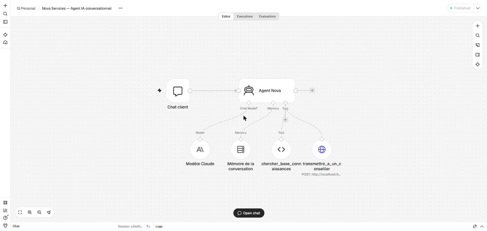

# Agent IA Nova — assistant conversationnel dans N8N

Nova répond aux questions courantes des clients de Nova Services à partir des ressources de l'entreprise. Quand une demande demande une intervention humaine, il la transmet à un conseiller.

```
Demande utilisateur → Agent IA N8N → Base de connaissances → Réponse ou outil → Transmission à un conseiller
```



## Fichiers

| Fichier | Rôle |
|---|---|
| `workflow-agent-nova.json` | Le workflow de l'agent, à importer dans N8N (généré, ne pas modifier à la main) |
| `instructions-systeme.md` | Les instructions système de l'agent (rôle, règles, garde-fous) |
| `base-connaissances/*.md` | Les ressources de Nova Services (fictives, écrites pour l'exercice) |
| `generer-workflow-agent.mjs` | Construit le workflow à partir des deux éléments ci-dessus |
| `tester-agent.mjs` | Joue les 8 scénarios de test et affiche les réponses |
| `resultats-tests.md` | Le résultat des tests |
| `captures/` | Le workflow, une conversation, une exécution où l'outil est utilisé |

## Comportement défini

| Question | Réponse |
|---|---|
| **Rôle** | « Nova », l'assistant en ligne de Nova Services |
| **Objectif** | Répondre aux questions courantes, et transmettre à un conseiller ce qu'il ne peut pas traiter |
| **Demandes traitées** | Services, horaires, contact, tarifs, devis, paiement, procédures simples, informations clients |
| **Informations utilisées** | Uniquement les extraits renvoyés par la base de connaissances, jamais ses connaissances générales |
| **Outils** | 2 seulement : `chercher_base_connaissances` (lecture) et `transmettre_a_un_conseiller` (action) |
| **Action autorisée** | Transmettre une demande à l'équipe (rappel, devis, panne, résiliation, réclamation, question sans réponse) |
| **Contrôle avant l'action** | Nom + email + objet obtenus, récapitulatif, puis « oui » explicite de la personne. Un seul appel |
| **Passage à un humain** | Demande de rappel, démarche impossible pour l'agent, question sans réponse acceptée en transmission |
| **Quand il ne sait pas** | Il le dit (« Je n'ai pas cette information dans mes ressources ») et propose la transmission. Il n'invente jamais un prix, un délai ou une procédure |
| **Demande vague** | Une seule question de précision avant de répondre |
| **Hors périmètre** | Refus poli, rappel de ce qu'il peut faire |
| **Ton** | Français simple, 2 à 5 phrases, source citée entre parenthèses |

Le texte complet est dans [`instructions-systeme.md`](instructions-systeme.md).

## Construction dans N8N

| Nœud | Rôle |
|---|---|
| **Chat client** (Chat Trigger) | La fenêtre de discussion, accessible sur `http://localhost:5678/webhook/6f1d3c52-…/chat` |
| **Agent Nova** (AI Agent) | Lit les instructions système, décide de chercher, de répondre ou d'utiliser l'outil. 6 étapes au plus par message |
| **Modèle Claude** | Claude Haiku 5.5 (`claude-haiku-5-5`), 1 024 tokens au plus par réponse |
| **Mémoire de la conversation** | Les 10 derniers échanges de la session, pour suivre une conversation en plusieurs messages |
| **chercher_base_connaissances** (outil Code) | Le RAG simple (voir plus bas) |
| **transmettre_a_un_conseiller** (outil HTTP) | Envoie nom, email et objet au workflow du défi précédent (`POST /webhook/nova-demande`). Ce workflow vérifie les champs, catégorise la demande, l'enregistre dans Google Sheets et prévient le service par email |

### La base de connaissances (RAG simple)

- **6 ressources** (services, horaires et contact, tarifs, FAQ, procédures, informations clients), découpées en **36 sections**, une par titre `##`.
- **Recherche par mots-clés pondérés** :
  - les accents et les mots vides sont retirés ;
  - des synonymes sont appliqués (« prix » → tarif, « rappeler » → rappel…) ;
  - un mot rare compte plus qu'un mot présent partout ;
  - l'outil renvoie les 4 meilleurs extraits avec leur source, ou `AUCUN_RESULTAT`.
- **Pourquoi pas une base vectorielle ?** Les ressources tiennent en 36 sections. Une recherche par mots suffit, elle ne coûte rien, et on peut vérifier exactement ce que l'agent a lu dans *Executions*. Elle ne demande pas non plus de deuxième fournisseur d'IA pour les « embeddings ».
- **Mettre à jour les connaissances** : modifier un fichier de `base-connaissances/`, lancer `node n8n/agent/generer-workflow-agent.mjs`, puis réimporter le workflow.

## Tester

```bash
node n8n/agent/tester-agent.mjs
```

8 scénarios, dont une conversation en 3 messages pour l'outil. Résultats : [`resultats-tests.md`](resultats-tests.md), **8 sur 8**.

On peut aussi discuter avec Nova dans le navigateur, sur l'adresse du nœud « Chat client ».

## Maîtrise des risques

| Risque | Mesure |
|---|---|
| **Clés exposées** | La clé Claude est saisie dans N8N, qui la chiffre. Elle ne figure ni dans le workflow, ni dans le dépôt. N8N et le chat ne sont joignables que depuis le PC (`127.0.0.1`) |
| **Trop d'outils** | 2 outils seulement : une lecture et une action. Pas d'accès au web, aux fichiers, aux emails ni aux comptes |
| **Action sans contrôle** | Coordonnées complètes, récapitulatif et « oui » explicite avant l'appel. Le workflow appelé revérifie les champs et rejette une demande incomplète. Le test n° 7 montre une seule transmission, après le « oui » |
| **Hallucinations** | Réponses limitées aux extraits trouvés, source citée, `AUCUN_RESULTAT` pour forcer l'aveu d'ignorance. Les tests n° 4 (bureaux à Marseille) et n° 6 (gratuité réclamée) le montrent |
| **Hors périmètre et manipulation** | Règles fixes dans les instructions système. Les messages et les extraits sont traités comme des données, pas comme des ordres (tests n° 5 et 6) |
| **Données sensibles** | L'agent ne demande jamais de mot de passe et conseille de ne pas en partager (test n° 8). Les exécutions sont effacées après 14 jours |
| **Coûts** | Haiku 5.5 (le moins cher), 1 024 tokens au plus par réponse, 6 étapes au plus par message, mémoire limitée à 10 échanges. Mesuré : 10 messages de test ≈ 0,005 $ |
| **Erreurs** | Chaque message est une exécution N8N (*Executions*), où l'on voit les recherches faites, les extraits lus, l'appel à l'outil et sa réponse |

**Limites connues**

- Le chat est public au sens de N8N : n'importe qui ayant accès à l'adresse peut l'utiliser. C'est sans risque tant que N8N reste sur le PC. Pour une mise en ligne, il faudrait l'authentification du nœud *Chat Trigger* et une limite de débit.
- La recherche par mots-clés peut manquer une formulation très éloignée des ressources. L'agent relance alors une recherche avec d'autres mots, puis avoue ne pas savoir plutôt que d'inventer.

## Installation

Il faut d'abord N8N lancé et le workflow du défi précédent (voir [`../README.md`](../README.md)).

1. Importer `workflow-agent-nova.json` dans N8N avec *Import from File…*.
2. Dans le nœud **Modèle Claude**, créer un identifiant *Anthropic* avec sa clé API. On peut limiter les domaines autorisés à `api.anthropic.com`.
3. Publier le workflow, puis ouvrir l'adresse du chat.
