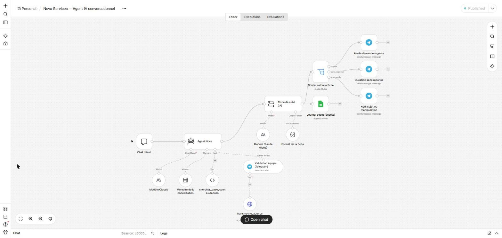
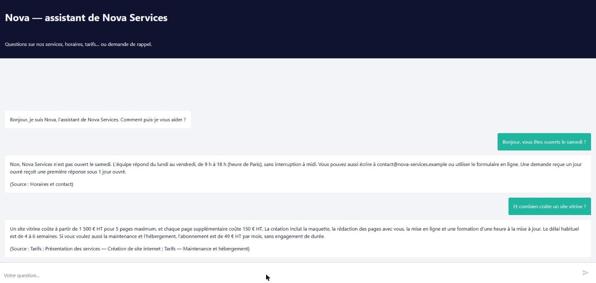

# Agent IA Nova — assistant conversationnel dans N8N

Livrable du workshop « Conception et déploiement d'agents IA ». Nova répond aux questions courantes des clients de Nova Services à partir des ressources de l'entreprise. Quand une demande demande une intervention, il la transmet à un conseiller, **après validation d'un membre de l'équipe**.

```
Demande utilisateur → Agent IA N8N → Base de connaissances → Réponse ou outil
                    → Validation humaine (Telegram) → Transmission au workflow des demandes
```



## Les documents

| Document | Contenu |
|---|---|
| [`cadrage.md`](cadrage.md) | Rôle, objectif, classement des demandes, données et outils autorisés, validation, formats de réponse, choix de conception |
| [`instructions-systeme.md`](instructions-systeme.md) | Les instructions système complètes de l'agent (règles et garde-fous) |
| [`base-connaissances/`](base-connaissances/) | Les 6 ressources de Nova Services (fictives, écrites pour l'exercice) |
| [`plan-de-tests.md`](plan-de-tests.md) | 12 scénarios avec résultat attendu et obtenu, anomalies corrigées, coût, transcription |
| `workflow-agent-nova.json` | Le workflow de l'agent, à importer dans N8N (généré) |
| `workflow-alertes-erreurs.json` | Le workflow d'alerte en cas d'erreur (généré) |
| `generer-workflow-agent.mjs` | Construit les deux workflows à partir des instructions et de la base |
| `tester-agent.mjs` | Joue les scénarios de test |
| `captures/` | Le workflow, une conversation, une exécution avec l'outil |

## Construction dans N8N

| Nœud | Rôle |
|---|---|
| **Chat client** (Chat Trigger) | Fenêtre de discussion publique sur le PC. La réponse s'affiche au fil de l'eau (streaming) |
| **Agent Nova** (AI Agent v3.1) | Lit les instructions système, choisit de chercher, de répondre, de demander une précision ou d'utiliser l'outil. 6 étapes au plus par message |
| **Modèle Claude** | Claude Haiku 5.5, 1 024 tokens au plus par réponse |
| **Mémoire de la conversation** | Les 10 derniers échanges de la session |
| **chercher_base_connaissances** (outil Code) | Le RAG simple : recherche par mots-clés pondérés dans 36 sections, renvoie au plus 4 extraits sourcés ou `AUCUN_RESULTAT` |
| **Validation équipe (Telegram)** | Porte de validation humaine placée devant l'outil d'action. Un membre de l'équipe reçoit nom, email et objet, puis clique **Approuver** ou **Refuser** (30 minutes au plus) |
| **transmettre_a_un_conseiller** (outil HTTP) | Envoie la demande au workflow du workshop N8N (`/webhook/nova-demande`). Ce workflow vérifie, catégorise, enregistre dans Google Sheets et prévient le service par email |
| **Fiche de suivi (IA)** + **Format de la fiche** | Après chaque réponse, un appel court classe l'échange dans un format fixe : type de réponse, catégorie, priorité, information manquante, base trouvée, raison |
| **Journal agent (Sheets)** | Inscrit la fiche dans l'onglet « Journal agent » de la feuille Google |
| *Workflow* **Alertes d'erreur** | Toute exécution en erreur, de l'agent ou du workflow des demandes, envoie une alerte Telegram avec le nœud fautif et le numéro d'exécution |

Le rôle, les règles et les choix de conception sont détaillés dans [`cadrage.md`](cadrage.md).

## Résultats des tests

**12 scénarios sur 12** ([`plan-de-tests.md`](plan-de-tests.md)) :
- question connue et reformulée ;
- question imprécise ;
- réponse absente ;
- hors périmètre ;
- manipulation ;
- demande de rappel ;
- validation approuvée et refusée ;
- demande à plusieurs sujets ;
- mot de passe envoyé ;
- erreur technique simulée.

**Coût** : environ 0,0005 $ par message, fiche de suivi comprise.



## Maîtrise des risques

| Risque | Mesure |
|---|---|
| **Clés exposées** | Les clés Claude, Google et Telegram sont saisies dans N8N, qui les chiffre. Elles ne figurent ni dans les workflows ni dans le dépôt, et l'identifiant de discussion Telegram n'y est pas non plus. N8N n'écoute que sur `127.0.0.1` |
| **Trop d'outils** | 2 outils : une lecture et une action. Pas d'accès aux emails, comptes, paiements, fichiers ni au web |
| **Action sans contrôle** | Triple contrôle : « oui » du client, **validation d'un membre de l'équipe sur Telegram**, puis revérification des champs par le workflow appelé |
| **Hallucinations** | Réponses limitées aux extraits trouvés et source citée. `AUCUN_RESULTAT` oblige à reconnaître l'absence d'information. Champ « info trouvée dans la base » dans le journal pour le contrôle |
| **Hors périmètre et manipulation** | Règles fixes. Le message du client n'est jamais inséré dans les instructions système |
| **Données sensibles** | Jamais de mot de passe ni de coordonnées bancaires demandés. Exécutions effacées après 14 jours |
| **Coûts** | Haiku 5.5, plafonds de tokens et d'étapes, mémoire limitée. Coût mesuré dans le plan de tests |
| **Erreurs** | Chaque message est une exécution N8N consultable. Les exécutions en erreur déclenchent une alerte Telegram (test n° 12) |

## Installation

Il faut d'abord N8N et le workflow du workshop N8N (voir [`../README.md`](../README.md)).

1. Importer `workflow-alertes-erreurs.json` puis `workflow-agent-nova.json` dans N8N.
2. Créer les identifiants :
   - **Anthropic** (nœuds « Modèle Claude ») ;
   - **Telegram** (le jeton d'un bot créé avec @BotFather) ;
   - **Google Sheets** (nœud « Journal agent »).
3. Renseigner l'identifiant de discussion Telegram de l'équipe dans les deux nœuds Telegram, et l'adresse de la feuille dans « Journal agent ».
4. Dans les réglages du workflow de l'agent, choisir « Alertes d'erreur » comme *Error workflow*.
5. Publier les workflows et ouvrir l'adresse du nœud « Chat client ».

La variable `WEBHOOK_URL=http://n8n.localhost:5678/` du `docker-compose.yml` est nécessaire : Telegram refuse les liens vers `localhost`.
